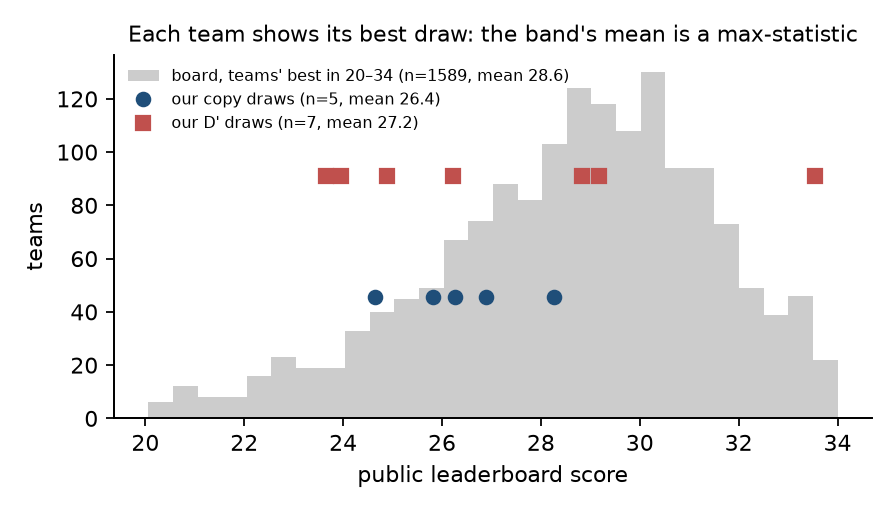
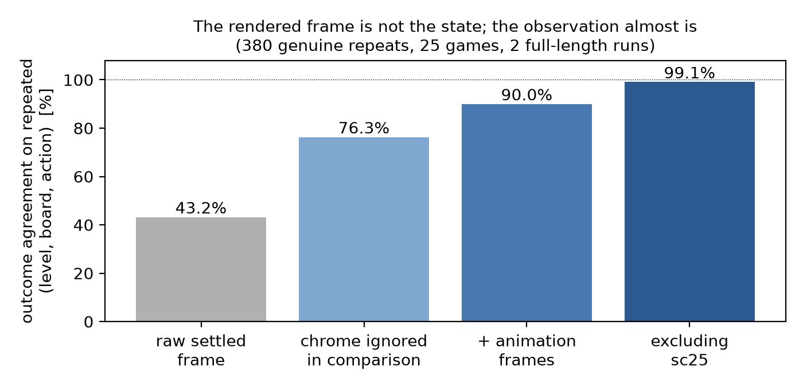
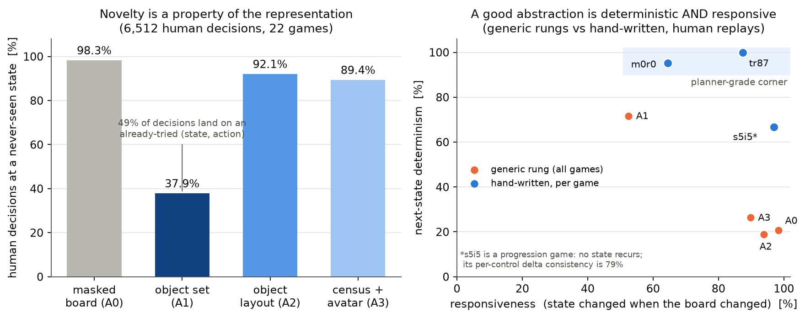
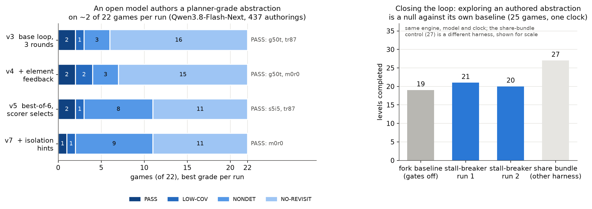
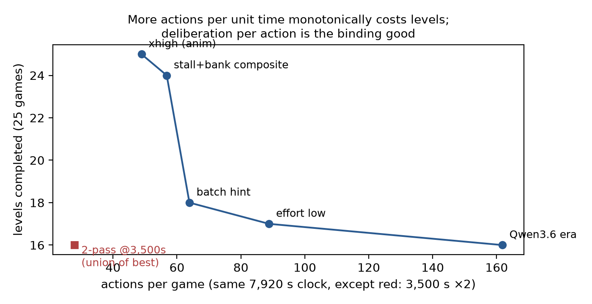
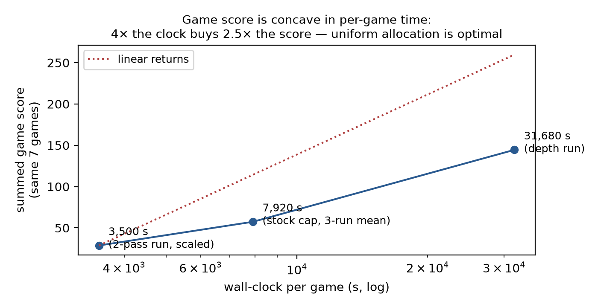
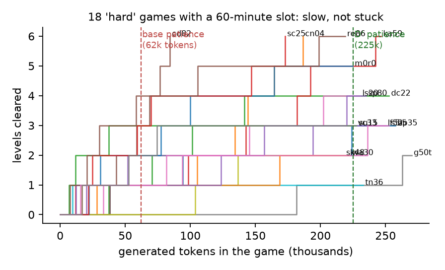
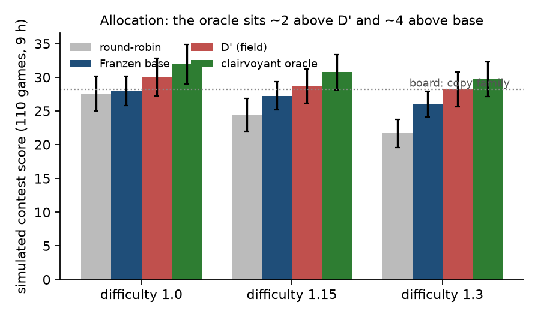
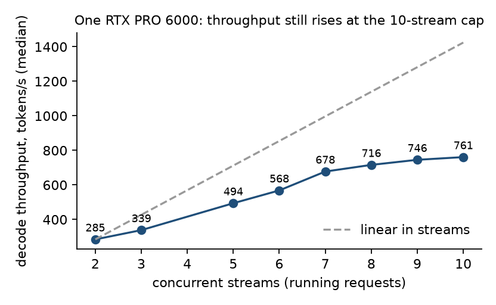

# The agent starts like an agent and stops like a coin flip
## A computational-neuroscience dissection of why humans solve ARC-AGI-3 and an LLM agent does not

*Draft v2, 2026-10-22. Every figure and number here was measured by us from
artefacts in the linked repository, with one script per claim (Appendix B).
Figures from other people's work are quoted and attributed. Where something is
unverified, the text says so.*

---

## Abstract

ARC-AGI-3 scores Relative Human Action Efficiency: how few actions an agent
needs to clear the levels of games it has never seen, against a human baseline.
Humans solve 100% of its games; the open LLM agents that win its public
milestones clear a few levels per game. We ask the question the way a systems
neuroscientist would: decompose the human solution into faculties, measure each
one in the agent against ground truth, intervene on each, and see what moves.
Three ground truths make this possible — 6,512 recorded human actions on 22
public games (168 level completions), random and clairvoyant policies under the
same budgets, and the game engine itself — on the two open harnesses that won
the competition's milestones (Qwen3.8-27B; Qwen3.8-Flash-Next, 180B).

The ledger that results is the paper. *Contingency detection* is near-human (94%
of actions change the board; humans 98.7%). *Action efficiency* is super-human:
over 775 cleared levels the agent used a median 0.67 of the human baseline and
its efficiency term sits at 1.05 against a cap of 1.15, so the score is depth
and nothing else. *Object and agent tracking* is partial: a theory fitted by
counting — the thing that moved last is the agent, it translates per key unless
a colour that blocked before is in the way — predicts 72% of the direction
transitions humans produced, and 46% when the agent is treated as a colour
rather than an object; in 40% of the public games no single object ever moves.
*Dynamics induction* is slow: what a counter predicts, the model re-derives in
six to ten turns per level. *Prediction-error learning*, *replay*, and four
further brain-inspired protocols were adopted by the model and changed nothing;
a written hypothesis space of level objectives was not taken up at all, and the
counting theory of motion handed to the model after every action left tokens per
level unchanged.
*Objective inference* is the deficit: the colour the agent enters at a
level-completing action is the game's modal colour in 76% of completions, and a
planner aimed at it in the fitted theory, re-planning on surprise in the real
engine, clears 0 of 37 levels — on dc22 it reaches the goal in 20 actions where
the human used 55 and nothing happens, because objectives are multi-step causal
chains and the colour is their signature. An open model asked to author the
abstraction that encodes such chains succeeds on 4 of 22 games in 437 attempts;
the strongest system on the benchmark buys it in context at $19,000–26,000 per
game. *Effort allocation* — the one lever that acts solely in the hidden
nine-hour run — is bounded by a calibrated simulator at +4 points over the
winning harness's priority and +2 over the field's best retune; throughput,
not allocation, binds.

The instrument is part of the finding. Each team displays its best draw, so the
leaderboard's middle is a max-statistic: a fixed configuration drawn daily has
standard deviation 2.7–3.5 at the 27-point level, 76 one-shot copies of the
winning notebook scored mean 26.8 and maximum 36.1, and the retune advertised at
31–32 scores 27.2 per draw. Executing anything in the harness's customisation
hook costs 0.448 of score; the engine's UNDO reverts the board in 1 of 25 games;
the rendered frame is not a sufficient state until the animation frames every
implementation discards are kept (repeat agreement 43% → 90%).

At Marr's computational level the task is joint inference of dynamics and
objective under core-knowledge priors; at the algorithmic level, the local parts
(agent, dynamics, goal signature) are cheap and the objective's causal chain is
a structured search the model performs in context, slowly, and no module we
attached could perform for it; at the implementational level the brain pays with
dedicated systems and the agent pays in generated tokens on one GPU, which makes
allocation and throughput the whole economics of a run. We close with a
theory-based harness in which code owns what counters already predict and every
token goes to the chain, and three falsifiable predictions.

---

## 1. Introduction: the question at the computational level

Chollet defines the intelligence of a system as "a measure of its
skill-acquisition efficiency over a scope of tasks, with respect to priors,
experience, and generalization difficulty" (Chollet 2019). ARC-AGI-3 makes that
definition interactive: the score is Relative Human Action Efficiency, the agent's
per-level action count against "the second-best human action count" (ARC-AGI-3
Technical Report, 2026). The benchmark constrains what knowledge is admissible:
its environments "only leverage Core Knowledge priors", and "humans can solve
100% of the environments, in contrast to frontier AI systems which, as of March
2026, score below 1%". That constraint is inherited from Chollet, who prescribes
that a test "should only feature tasks that assume the four core knowledge
systems", and from Spelke & Kinzler (2007), whose taxonomy — objects, agents,
number, geometry — Chollet is naming.

So the benchmark is a cognitive-science artefact by construction, and the
methods that do best on it are not. The nearest published work to ours in
constraints, Rudakov, Shock & Cowley's training-free graph exploration, grounds
itself in Go-Explore, MuZero and curiosity; the field's winning open harnesses
are engineering reports. This paper does the arithmetic the other way round.
Humans solve these games because they bring a structured hypothesis space
about objects and agents and infer, from one or two interactions, a game's
dynamics and its objective — theory-based reinforcement learning in Tsividis et
al.'s (2021) sense, the account of why people learn an Atari game in minutes.
We ask which parts of that solution an LLM agent has, by measuring each part
against the human data the benchmark was calibrated on and a random floor, and
by intervening on each part in the harness and reading what moves.

The result is a ledger (§3) whose rows are faculties and whose entries are
measurements, and a conclusion that no single intervention could have reached:
perception, motion and efficiency are not the gap, allocation is a small one,
and the deficit is the inference of an objective's causal chain — the same
capability a forward experiment on abstraction authoring locates, and the one
the strongest frontier system buys in context at a price. Along the way the
instrument itself had to be characterised: a leaderboard that displays each
team's best draw, a measurement channel with a hidden tax, an observation that
is not a state, an engine whose UNDO is a no-op. §2 does that first, because
nothing after it can be read without it.

### 1.1 Prior work

*The benchmark and its priors.* Chollet (2019) defines intelligence as
skill-acquisition efficiency under priors and frames the core-knowledge
systems a test may assume; the ARC-AGI-3 Technical Report (2026) instantiates
them interactively as Relative Human Action Efficiency against a human
baseline. Spelke & Kinzler (2007) give the object/agent distinction this paper
measures; Dubey et al. (2018) show by masking that the object prior is the one
whose removal costs human players most. Lake et al. (2017) argue for causal
world models, compositionality and learning-to-learn as the ingredients of
human-like learning; Tsividis et al. (2021) show that an agent that infers a
game's theory and plans in it learns Atari games at human speed — the account
whose parts our ledger tests one at a time.

*Methods on ARC-AGI-3.* The open harnesses that won the competition's milestones
(Tufa Labs' Duck harness, June; Franzen's patched Duck harness with
Qwen3.8-Flash-Next, September) are LLM tool-use loops with a Python sandbox;
we instrument both. Rudakov, Shock & Cowley (2025) reach a strong training-free
result with graph-based state-space exploration; Rodionov (2026) induces
executable world models verified by replay with frontier models, which §4.3
tests the precondition of. ARC Prize's analysis of GPT-6 Astra (2026)
documents in-context symbolic world modelling at $19,000–26,000 per game, and
OpenAI's provider-adapter results (2026) document a harness effect of
thirty-seven points on one model — the confound §2.2 measures at the kernel
level. Affectify's published slot-priority retune (2026) is the field's
discovery of the allocation lever §7.2 bounds.

*Brain-inspired mechanisms we tested.* Predictive coding (Rao & Ballard 1999;
Friston 2010) as a predict-then-check loop; prioritised replay (Mattar & Daw
2018) as harness-driven replay of retained solvers; model-based control with
arbitration (Daw et al. 2011) as a gated planner; directed exploration as an
orienting census; resource-rational effort allocation (Lieder & Griffiths
2020; Shenhav et al. 2013) as the scheduler's priority. Each appears in §6 or
§7 with its measurement.

## 2. Approach I: instruments — three ground truths and two confounds

### 2.1 Chassis, ground truths, and the two contracts

Two open harnesses were instrumented. The Milestone-1 winner (Tufa Labs' Duck
harness, Qwen3.8-27B-FP8 through vLLM) served the measurements of §4–§5 on the
25 public games at a per-game cap of 7,920 s. The Milestone-2 winner (Franzen's
patched Duck harness, Qwen3.8-Flash-Next (a 180B-parameter mixture of experts; Hugging Face
safetensors total 1.80 × 10¹¹) in Intel's AutoRound W4A16 quantisation with an
MTP drafter on the Pennyroyal SGLang fork) served the
October measurements, our leaderboard draws, and the allocation study of §7.
Both run offline on one RTX PRO 6000.

**The linked submission.** The Kaggle entry this paper is linked to is
`tantan0327/arc3-franzen-dprime`: Franzen's Milestone-2 notebook, byte for byte
(Tufa's Duck harness under MIT, his Apache-2.0 patch, Qwen3.8-Flash-Next in
Intel's AutoRound W4A16 with albucino's INT4 MTP drafter under the Qwen
Community licence, the Pennyroyal SGLang fork under Apache-2.0), plus one cell
of ours: a clean-room, CC0 implementation of the published D' slot priority
(`scripts/patches/priority_form.py`, §7.2). Its daily draws are the D' series
of §2.3; its best public draw is 33.55 and its per-draw mean 27.2. Everything
else in this paper is measurement around that entry and its predecessors, not
part of it.

Three ground truths. **Human replays:** the official human solutions of 22
public games — 6,512 actions, 168 level completions — replay 22/22 in sync on
the local engine against reference solutions whose continuous integration
asserts a score of exactly 100.0. **Policy floors:** a random policy on the same
25 games with twice the summed human baseline as its budget, and a clairvoyant
policy where a bound is needed (§7). **The engine:** every claim about
transitions is checked by executing actions, not by reading frames.

Two contracts. The author's 25-minute, ten-game demonstration gives each game
its own stream, so nothing competes for the model; the hidden nine-hour run
plays ~110 games on ten model slots. Everything measured on the demonstration
is a per-game measurement; only the board can see allocation (§7).

### 2.2 The channel: executing anything in the customisation hook costs 0.448

The Milestone-1 harness offers a customisation hook for exactly the kind of
modification an experiment needs. **Executing anything in it costs 0.448 of
leaderboard score.**

    unmodified draws          0.95  0.98  1.11  1.14  1.20  1.23
    hook arms                 0.58  0.60  0.69  0.72  0.74
                                    ^ the null control

The null control imports a module already in `sys.modules` and prints its
length. It drew 0.60, and on replication 0.59; six against six with no overlap,
exact permutation p = 0.0079. We could not find the mechanism — throughput is
unaffected, cold-starting is refuted, the module does no work — and we report
it for what it does to other people's results: any modification shipped through
that hook must be worth 45% of the score to break even, and we cannot know how
many shared results on this harness were measured through it. Our own
measurements use a substitution on the harness's setup commands, verified
clean (a null substitution scored 1.20). The effect is not a quirk of one
notebook: the frontier labs have since reported the same confound at scale —
GPT-6 Astra scores 62.7% through a provider-neutral interface and 99.9% through
its own adapter, whose only additions are retained notes and compacted
reasoning (OpenAI 2026; confirmed by the ARC Prize Foundation). A leaderboard
number on this benchmark is a joint measurement of a model and the software
around it.

### 2.3 The leaderboard is a max-statistic, and it manufactures a wave

The board keeps each team's best submission, and most entrants fork a few
public recipes. That makes its upper band a max-sampling artefact, and we can
show it with our own draws. At the 1-point scale two fixed configurations drawn
four times each gave sd 0.10 and 0.20; under that distribution six hundred teams
keeping the best of about five draws should put 67 teams above 2.0, and 66 were
observed. We then ran the experiment: the top public kernel, advertising 2.23,
forked byte for byte and submitted, scored 1.22. Six draws of one unchanged
recipe later climbed 2.45 → 3.92 and carried the same bytes from ~200th to
~77th place.

The field then ran the experiment for us at the 27-point scale. When the
Milestone-2 first place published his notebook, hundreds of teams submitted one
copy each: 76 one-shot copies scored **mean 26.8, sd 3.55, maximum 36.1** against
the author's own best of 27.9, and the top-100 line moved from 4.9 to 28.2 in two
days. When one team published a retuned slot priority ("D'", §7.2) its single
submission showed 31.54 and three copies 30.8–31.9, all displayed as bests; our
daily draws of a clean-room implementation of the same formula scored 23.95,
23.66, 28.83, 33.55, 29.18, 26.23, 24.88, 25.55, 29.35 — **mean 27.2** — against
our byte-identical copy's 26.3. The board's "copy band" (1,661 teams between 20
and 34 on 2026-10-20) has mean 28.7 for the same reason: per-draw means sit about
two points below what the board displays (Fig. 1). Single-draw comparisons
measure nothing; "best submission" among copies ranks luck. The top of the board
is another matter — the leading teams sit tens of standard deviations above any
public family — and that is exactly what the public band is not.

### 2.4 Noise, and the decision rules it forces

A fixed configuration drawn daily on the board has sd 0.47 at 3 points and
2.7–3.5 at 27; the offline instrument (25 games, full length) has sd ≈ 3 levels
on 32–45 with per-game ranges wider than any single-change effect we measured
(lp85 2–6 levels across three runs of one notebook). An independent team
reported the same instrument in the forum: two runs of an identical build,
back to back, 2.60 and 1.45. A three-draw family mean on the board has standard
error about 0.3 at the low scale and 1.6 at the 27-point scale; it resolves a
difference of one or two points and nothing smaller. Every family decision in
this paper was therefore pre-registered as a three-draw mean against a
threshold; offline totals were never used to decide anything, because a total is
a sum of per-game draws whose individual ranges exceed any effect we measured;
the only offline signal treated as readable was a per-game flip outside that
game's own range with no game falling below its range, and an arm that moved a
total without moving any game out of its range was read as noise. Under that rule, of thirty-odd single-change arms measured at full
length, one was weakly positive. Three of twelve competition reruns in October
failed at dataset mount and scored 0; zero-score draws are excluded from every
family mean. Appendix C lists every draw.

## 3. Approach II: the dissection, as a faculty ledger

The human solution decomposes into faculties that cognitive science and
systems neuroscience name and, in several cases, localise. Each row below is a
faculty, the model that describes it, the measurement we made of it in the
agent, and the verdict; the section that carries the measurement is named.

| human faculty | brain system / computational model | measurement | verdict | § |
|---|---|---|---|---|
| contingency detection: what my action affects | agent-detection signature (Spelke & Kinzler) | 94% of agent actions change the board; humans 98.7% | human-level | 4.2 |
| action efficiency | the agent signature "efficient means" | 775 cleared levels: median actions/baseline 0.67; efficiency term 1.05 vs cap 1.15; 84% at ≥1.0 | super-human | 4.2 |
| object permanence; the agent as an object | ventral stream; core-knowledge object system | code tracks the agent through 72% of human direction moves as an object, 46% as a colour; no single object moves in 40% of games | partial | 4.4, 5.1 |
| sufficient state (perception) | — | repeat agreement 43% as rendered, 90% with the animation frames the harness discards | repairable | 4.3 |
| dynamics induction (theory of the mechanics) | theory-based RL (Tsividis); model-based learning | a counter predicts 72% of transitions; the model re-derives mechanics in 6–10 turns per level | slow | 5.1 |
| prediction-error learning | predictive coding (Rao & Ballard; Friston) | predict-then-check loop adopted (474 hits / 140 misses); levels unchanged | null | 6 |
| consolidation and replay | hippocampal replay (Mattar & Daw) | retained solver replayed by the harness: 2 of 45 replays cleared a level | null | 6 |
| directed exploration | novelty / information gain | an orienting census (not read: platform failures); four prompt-level arms null | null / untested | 6 |
| objective inference | OFC/vmPFC goal representation; structure learning | 76% of completions enter the modal colour; a planner on that goal clears 0 of 37 levels; an open model authors the abstraction on 4 of 22 games | **the deficit** | 5.2–5.4 |
| effort allocation (metacontrol) | ACC; resource rationality (Lieder & Griffiths; Shenhav) | calibrated simulator: oracle +4 over base, +2 over the field's retune; +1 per draw measured | small | 7 |
| measurement | psychometrics | best-of-draws board; per-draw sd 2.7–3.5; hook tax 0.448 | method | 2 |

The brain mappings organise the measurements; they are not themselves
measured, and §10 says where a row has no evidence behind its mapping. What the
ledger shows at a glance is the shape of the result: the bottom-up faculties are
present or repairable, the interventions that imitate learning mechanisms are
null, and the one empty row is the top-down one.

## 4. Results I — perception and action: what the agent has

*Sections 4–7 are the results, in the ledger's order: bottom-up faculties first (§4), the dynamics and the objective (§5), the interventions (§6), the economics of the run (§7). Leaderboard numbers are in §2.3 and Appendix C; every offline number is a public-game measurement.*

### 4.1 Starts like an agent, stops like a coin flip

Against the random floor, on the same games and the same budget:

    clears at least one level     agent 11 / 25  (44%)     random 2 / 25  (8%)
    finishes the game             agent  0 / 25            random 0 / 25

The agent is 5.5× chance at getting started and exactly equal to chance at
finishing. Whatever it has, it spends in the opening. The per-level action counts
say where it goes: a level the agent completed took a median of 20 actions and
never more than 150; a level it stalled on burned a median of 122 and up to
397. **The agent does not fail by being slow; it fails by continuing.** The stall
has a signature the harness could read online: within the agent's own stream,
completed levels run at ~0.8 bits of action-type entropy while stalled tails
hold 1.0–1.13, and the chrome-masked novelty of the boards it reaches climbs
through completed levels (85.8% → 97.5%) and collapses through stalled ones
(90.8% → 78.5%). Humans run at 98.4–99.6% novelty and rising to the last action
of every level: nearly every human action moves the world somewhere new, which
is close to a policy invariant on these games. The 60-minute traces of §7 add
the other half: the games that stall in 25 minutes are slow, not stuck — given
an hour each, eighteen of them cleared 69 levels.

### 4.2 Contingency, and efficiency at the cap

Spelke lists contingency and efficiency as signatures of agent representation,
and the agent has both. 94% of its actions change the board, against a human
98.7%; true cycling is 2.3% and uncorrelated with score; the 13.9% of actions
that leave the board unchanged (human 0.6%) are not the gap, because removing
them does not follow through to levels. On the 180B chassis we compared, for
every one of 775 cleared levels, the agent's actions with the human baseline the
scorer uses: the median ratio is 0.67 (quartiles 0.50–0.90), the mean efficiency
term 1.05 against the 1.15 cap, 84% of cleared levels at or above 1.0. Holding
levels fixed and raising every term to the cap adds 8%; raising them to 1.0
would lower the score. The agent is more action-efficient than the humans it is
measured against on the levels it clears; everything it fails to score is a
level it never reached. **For this class of agent the metric is depth, and
nothing else.** (The scorer caps at 1.15 where the published formula says 1.0;
Appendix A.)

### 4.3 The observation is not a sufficient state

The strongest published results on ARC-AGI-3 induce an executable world model —
the agent writes code that predicts the next board — and verify it by exact
replay against observed transitions (Rodionov 2026). That rests on an
assumption the papers state and do not test: that the rendered frame is a
sufficient state. Every recorded transition is a (level, rendered board,
action) → board triple; collisions on the first three with disagreement on the
fourth are proof of state the frame does not show.

    380 repeats of an identical (level, rendered board, action)
      as rendered                            216 contradictions    43.2% agree
      ignoring chrome when comparing          90                   76.3% agree
      + conditioning on the animation frames  38                   90.0% agree

The failure is rendered instrumentation, not physics: counters on row 0, a bar
draining along row 53. They are found not by volatility but by **isolation** — a
cell is instrumentation if it changes while nothing else does. The second repair
costs nothing: the harness defines `frame` as the final visible frame and
`animation_frames` as the rest, and every implementation we know of discards
them by taking `frame[-1]`. Sixteen of the eighteen games with repeats are then
perfectly deterministic; lf52's 49 contradictions are all distinguishable in the
preceding animation frames; sc25 alone holds 35 of the 38 unexplained cases, and
excluding it the agreement is 99.1% (Fig. 2). A correction we owe the reader:
our first version reported 93.4% by masking the board before keying, which made
distinct states collide; the honest chrome-masked figure is 76%.

### 4.4 Objects and agents

Chollet's core knowledge systems separate objectness — "cohesion, persistence,
and contact" — from agentness and goal-directedness, and Spelke & Kinzler say
why: "Spatio-temporal principles do not govern infants' representations of
agents, who need not be cohesive, continuous in their paths of motion, or
subject to contact … Instead, the intentional actions of agents are directed to
goals, and agents achieve their goals through means that are efficient." The
entity an ARC-AGI-3 player controls is an agent; implementations treat it as an
object a direction key translates.

We measured whether that assumption holds (`scripts/measure_agency.py`): for
every direction press that changed the board, does the change read as one
connected object translating? Across three recorded runs on three harness
generations the classification is stable per game: one object accounts for ≥80%
of translating moves in 3–5 of 17 games, partially in 6–8, and never in 6–8
(cn04, tu93, lf52, cd82, re86, ls20; ar25 ≤1%). In roughly 40% of the public set
no direction press ever reads as an object moving; the avatar the engineering
practice assumes is reliably present in under a fifth. §5.1 measures the same
distinction a second way: a theory that tracks the agent as an *object* — the
thing that moved last, whatever its colour — predicts 72% of human direction
moves, and the same theory keyed on *colour* predicts 46% (re86 falls from 87%
to 2%). RHAE itself, measuring action efficiency against a human, is a
measurement of a core-knowledge agent signature — a stronger justification of
the metric than the benchmark offers.

Supplying object identity to the agent as a goal vocabulary, finally, degrades it
monotonically in the sharpness of the identity (colour 13/22 games, size class
12/22, exact shape 3/22) — the mirror image of Dubey et al.'s (2018) human
result, where removing the concept of objects is the costliest ablation. The
prior humans need most is one the agent does not use, and handing it over
explicitly makes play worse.

### 4.5 Novelty is a property of the representation

A sufficient state settles whether a world model can be sound, not whether it
is useful: on the 6,512 human decisions, 98.3% are taken at a masked board never
seen before in that game (0.9% at a state-and-action pair already tried). At
that representation there is nothing to plan over, which is why mechanical
frontier navigation measured null (§6). But novelty is a property of the
representation, not of the games. Re-measured up an abstraction ladder
(`scripts/measure_abstraction_ladder.py`), a bare object census (colour, count)
takes novelty to 37.9% with 49% of decisions at an already-tried state-action
pair, while positional rungs keep the distinctions and stay ~90% novel. No fixed
rung is the answer; the planner-grade corner is reached only by choosing which
variables matter for *this* game: three hand-written, game-specific abstractions
reach next-state determinism of 100%, 95% and a per-control delta consistency of
79% at revisit rates of 10–27%, where every generic rung is either blind or
never repeats (Fig. 3). With those abstractions standing in for authored ones, a
breadth-first planner over observed abstract edges re-solves 70 of 70 level
segments of the human trajectories in 24% fewer actions than the humans. That
is, to the letter, what the strongest agent on the benchmark does: ARC Prize's
analysis of GPT-6 Astra shows "on-the-fly symbolic world modeling" in a
self-invented shorthand — game-specific variable selections — at $19,000–26,000
per game against a $12.78 human baseline. The ladder locates the capability
precisely: not search, not memory, not planning, but the authoring of the
abstraction.

## 5. Results II — dynamics and objective: where the deficit is

### 5.1 Theory induction by code

If the agent's slowness is slow theory induction, the natural test is whether a
code-fitted theory — no model, no tokens — predicts the transitions humans
produced. We replayed the 22 human solutions on the local engine and fitted,
online, the simplest theories Spelke's systems license
(`scripts/test_theory_induction.py`). Theory C: the thing that moved last is the
agent; under a direction key it translates by a fixed per-key offset unless the
cells it would enter hold a colour that has blocked it before. Theory D adds
what a second look at the failures demanded: a masked border (the timer bar
changes every action), a per-key step length (ar25's sprite moves three cells per
press) with a slide-until-blocked alternative chosen online by predictive score
(g50t), blocking learned over the whole sweep, and the agent chosen by continuity
first and contingency second when several things move. Each prediction is made
before the transition is seen and scored exactly: moved or not, in which
direction, how far (±1).

| game | C | D | game | C | D |
|---|---|---|---|---|---|
| dc22 | 95% | 95% | sp80 | 66% | 64% |
| cn04 | 87% | **92%** | ar25 | **61%** | 39% |
| re86 | 87% | **91%** | bp35 | 48% | 49% |
| g50t | 34% | **77%** | tr87 | 38% | 33% |
| lf52 | **74%** | 38% | sc25 | 33% | 33% |
| ka59 | 70% | **74%** | tu93 | 28% | 33% |
| wa30 | 69% | **72%** | sk48 | 69% | 70% |
| m0r0 | 66% | 68% | | | |

Over 4,083 direction transitions, C predicts 68%, D 67%, the better of the two
per game 72%. Click games are trivially regular (97–100% of clicked colours
behave as before) and are not the question. The games the theories miss — ar25
and tu93 below 40%, bp35, sc25, tr87 — are the ones whose sprites deform or
whose dynamics involve a second moving body: object identity under shape change
and multi-object interaction, what human vision supplies for free. Everything
else about movement — translation, step, blocking, sliding — a counter learns
from a handful of transitions, and the model re-learns at every level in six to
ten turns of tokens.

### 5.2 The goal is cheap; the objective is not

With the agent tracked, the goal is cheap to read: at the action that completed
a level, the colour the agent entered or clicked is the game's modal colour in
76% of 129 completions, and in dc22, g50t, ka59, r11l, sk48, tn36 and vc33 in
every one. "The level ends when you reach colour X" is inferable after one
completion in most games.

Then the planner test says what the objective is not. We closed the loop
(`scripts/test_theory_planner.py`): fit the theory on the human's level 1, take
the colour entered at the completing action as the goal, and let a
breadth-first planner in the fitted theory play levels 2 and up in the real
engine — plan, act, compare each outcome with the prediction, re-plan on
surprise, with the four direction keys given their named directions as a prior
and the board's dominant colour excluded from goals. It completed **0 of 37
levels** across eleven direction games. The planner is not the problem: on dc22
it reached the goal colour in 20 actions where the human used 55, and nothing
happened, because reaching that colour ends the level only after something else
has been done. The public games' objectives are multi-step and dynamic —
collect, then exit; toggle, then pass; push, then align — and a static "reach
colour X" captures the last step of each. The 76% is a *signature* of the
objective, not the objective.

### 5.3 Can the model author the abstraction?

We tested the capability the ladder names, directly. An open 180B model served
locally was shown a few frames and transitions of each of the 22 replay games
and asked to write `extract_state`; each result was scored against the human
replays on next-state determinism and revised on concrete feedback. Over five
runs and 437 authorings the model produced a planner-grade abstraction on **4
of 22 games** (determinism 92–100% at revisit rates of 13–36%, two of them
matching our hand-written references). Feedback, best-of-6 selection with the
scorer as selector, and handing the model the instrumentation cells our
isolation rule finds each changed *how* the other games failed and none changed
how many succeeded. The model writes perception code easily; on four games in
five it does not choose the right variables, and the harness can supply sound
parts but not the choice (Fig. 4). Wired into the harness as a stall-breaker —
after a fixed number of actions on a level without completing it, the harness
asks the model for an abstraction, scores it on the agent's own recorded
transitions, and if one passes explores the abstract state space systematically
in bursts of engine-speed actions, Go-Explore style, handing control back
between bursts — the loop ran cleanly across 25 games (abstractions authored on
13, adopted on 5, 1,617 planned actions) and completed 21 and 20 levels against
the fork's own gate-off baseline of 19 — a null. Offline, the same explorer
clears a maze level in roughly 850 actions that a random policy never clears,
and clears nothing on a tile puzzle or a progression game whose goals a human
sees at a glance: systematic coverage substitutes for wandering, not for
goal-directed play. A methods lesson is attached: our first comparison,
against 27 and 28 on a different bundle, was confounded and withdrawn, and the
bundle effect (19 vs 27–28 on the same engine and model) is larger than any
modification we measured.

### 5.4 The deficit, located three ways

Three independent routes arrive at one place. Imitation of what humans did (two
fine-tunes, the second on the harness's own rendering: 17 vs 20 and 3 vs 6
levels), retention of context, and an executable world model in both forms
failed, the harness-driven form at the source: 98.3% of decisions on a solved
trajectory occur at a board never seen before. A code-fitted theory predicts
72% of human movement and 76% of goal signatures and clears no level, because
objectives are causal chains the theory space does not contain. And the model,
asked to author such a space, succeeds on four games in twenty-two. What humans
supply at 100% is the inference of that chain from one or two interactions;
what the LLM supplies, slowly and at a price, is the same thing in tokens.
Neither a counter nor a search substitutes for it, and — §6 — neither does any
learning mechanism we attached.

## 6. Results III — interventions: the brain-inspired arms, and what moved

Each arm is one change on an otherwise unmodified harness, measured at full
length against the vehicle's band (§2.4), with the mechanism it implements and
the faculty it targets. The 27B arms ran on the Milestone-1 harness; the 180B
arms on the Milestone-2 notebook, where the band is 44/50/40 levels on the
ten-game demonstration (two further base-configuration runs read 52 and 44, so
the five-run band has mean 46 and sd 4.6) and the one precise metric is
per-stream throughput (62.6 tokens/s, sd 1.5 over fifteen runs).

| arm | mechanism it implements | faculty / model | read |
|---|---|---|---|
| predict-then-check (180B) | `predict(cells, note)` before each action; the sandbox reports HIT/MISS against the real diff | predictive coding | adopted: 474 hits, 140 misses, 32 unpredicted; levels 42 / 40 — null to negative |
| solver consolidation + harness replay (180B) | the model keeps one `solve_level()`; the harness runs it at each level start under a budget | consolidation, replay | 46 / 47 levels; 2 of 45 replays cleared a level: the model's solvers are in-turn subroutines, not policies |
| act-every-turn (180B) | 29% of turns execute no action; after one such turn the opener requires `action(...)` | habit / System 1 | 43 / 47 / 45 levels; tokens per level 21.2k / 19.8k / 20.5k vs 20.5k; turns −26%: the same thinking in fewer turns |
| orienting census (180B) | the harness executes each simple action once at level start and tabulates the diffs | orienting reflex | two runs lost to platform mount failures; the third (patient startup) read 46 levels, census executed at all 44 level starts, tokens per level 20.5k vs 17.8–22.7k — null |
| objective handbook (180B) | a 1,141-word prior over level objectives in the system prompt — twelve archetypes (navigate, collect-then-exit, key-and-door, push, match a reference, toggle, ordered sequence, route a beam, sort, counter, fill, select by property), each with how to recognise it, its sub-goal chain, the cheapest probe and the completion signal — plus a per-level protocol and a one-line per-turn reminder | core-knowledge hypothesis space over objectives (theory-based RL) | 42 / 50 levels; the vocabulary appears 14 and 25 times per run in the model's own text, hypotheses per run unchanged (294 / 234 vs 228–293 in the base runs) — not adopted |
| handbook v2 (180B) | + 719 words: three archetypes (assemble pieces, reduce to one, meet and merge) and eleven cross-game regularities distilled from the fifteen public games the demonstration never runs, so the test is held out (`docs/results/objective_archetypes_15_2026-10-24.md`) | same | 43 / 41 levels; 33 / 41 mentions; sb26, which the base clears 8/8/8, fell to 1 — null, with one visible cost |
| motion theory as sandbox helpers (180B) | the §5.1 counting theory in pure Python inside every tool call: `motion_theory()`, `predict_move(key)`, `path_to(target)` (offline: 64% agreement on 1,566 human direction presses, a route at 28 of 39 level starts, 0.09 s per build) | code owns dynamics — the §9 prescription at the advice level | 47 / 49 levels; the helpers were called 3 and 3 times per run — not adopted |
| motion theory, forced (180B) | the same prelude, and after every `action(...)` the tool output ends with a MOTION line: avatar box, per-key displacement or blocker, the theory's track record (674 / 961 lines delivered) | same, delivered without being asked | 47 / 45 levels; tokens per level 19.4k / 19.8k — delivered and null |
| handbook v2 + helpers (180B) | both of the above | both | 43 / 47 levels; helpers called 6 and 1 times — null |
| 96k context / 40k drain; 4096-token yield (180B) | cheaper prefix; fewer truncated turns | — | 43 levels, throughput 64.7 (+1.4 sd); 50 / 44 levels — null |
| physics facts in the prompt (27B) | which body the keys move, its position, step, blocking colours, learned from the agent's own moves | perception | 636 appearances in 16 games; 37 levels, in band |
| planner as tools `body()`, `goto()` (27B) | the learned rules execute a stated route in one turn | motor planning | reaches 5 of 9 rigid targets in the sandbox; 13 calls in 5 games in play, 0 reached; in band |
| planner as player, gated (27B) | the physics acts once 20 predictions verified, ≤1 in 10 wrong, 150 stalled actions | model-based control | 35 vs 34 levels: one gained, none lost; without the gate, 34 vs 34 |
| animation summary in the action result (27B) | the discarded intermediate frames, described | perception | 730 appearances, 25/25 games; 40 levels, in band |
| world-model note backfilled from reasoning (27B) | the cross-turn note the model leaves empty on 33–47% of turns | working memory | empties 33% → 20%; offline 38 vs 32; board +0.1 over six draws — weakly positive |
| retention ledger; mandatory hypothesis-experiment-verdict protocol (27B) | cross-game memory; prescribed reasoning form | working memory; metacognition | engaged in 25/25 transcripts; 23 vs 25 levels; protocol followed 900+ times, levels 25 → 18 |
| imitation fine-tunes (27B, two) | QLoRA on 6,512 human pairs; then on the harness's own rendered prompts | procedural learning | 65.5% held-out next-action accuracy, serves verifiably; 17 vs 20 levels; 3 vs 6 and 17 vs 27 |
| executable world model, model-authored / harness-driven (27B) | a verified transition-model API in the sandbox; a transition graph planned by the harness | model-based planning | never invoked in 25 games ("I should use the worldmodel tool … but first"); 19 either way; harness-driven null at the source (98.3% novel states) |

None moved depth. The last six arms were run in one night (2026-10-23/24),
eleven demonstration runs against the five-run band 44/50/40/52/44: 42 50 43 41
46 47 49 43 47 47 45 — mean 45.5, none above the band's maximum, none below its
minimum (Figure 10). Every one of the fourteen runs, base and arm alike,
generated 888–941k tokens (the 25-minute demonstration fixes the budget: tokens
are the clock) and spent 17.8–22.7k tokens per cleared level, so the arms are
compared at equal tokens and none changed the price of a level. Adoption must be
counted in the model's own text — the transcript repeats the system prompt every
turn and a naive count is inflated a hundredfold — and so counted it is near
zero for everything that was merely available: the objective vocabulary one to
four times per game, the helpers one to six calls per run, the number of stated
hypotheses unchanged. What was forced into the turn — the census table in the
opener, the MOTION line after every action, the HIT/MISS line of predict-then-check
— reached the model every time, and changed nothing. The pattern is uniform
across thirty-six arms, two chassis and four months: the model adopts every
protocol that is pushed into its turn — predicts, keeps solvers, follows the
hypothesis form, reads the facts, calls the tools at level 1 — ignores what is
only offered in the system prompt, and reaches the same levels either way. Where a tool was used it reached the target the
model chose in the optimal number of moves, and the target was wrong. Three
arms were void before they were null, and their reasons are methods results
worth more than the arms: injection through a method the harness defines and
never calls; a setup that overwrites the environment the notebook set; a wrapper
with a fixed signature that crashed under a bundle's extra keyword. Rule
adopted: before reading a run's levels, grep the transcripts for the injected
sentence and count helper *calls* in the model's code. A fourth lesson came
from a table of closed levers: ours listed "KV cache" as closed after 24 and 48
GiB failed to boot under speculative decoding; a two-person team found that
with the drafter off the same lever opens at 7 GiB, and their build drew 4.25
where ours drew 2.87. A row in a closed-lever table means closed under the
condition measured, and the condition belongs in the row. One engine fact belongs
here too: the harness advertises **UNDO** in every game, and on the local
engine UNDO reverts the board in 1 of 25 games; in 17 it is a no-op that still
costs an action (`scripts/test_undo_offline.py`). The model never used it, so the
defect is latent, but any design that relies on reversal — our census was one —
is void on this engine.

The one transferable positive is a gate, not a mechanism: the physics planner
helped (35 vs 34, none lost) only when it had *earned* the budget — predictions
verified on this level, a low error rate, the model stuck for 150 actions. A
mechanism added to a competent model must earn its budget or stay out of the
way; every ungated mechanism we measured took actions the model would have used
better.

## 7. Results IV — resource economics: allocation and throughput

### 7.1 Time is concave; the queue buys actions, not levels

On the Milestone-1 chassis, every intervention that increased actions per unit
time — a lower reasoning effort, batching hints, halving the per-game cap to buy
a second pass — cost levels monotonically; giving seven games four times the
clock returned 1.77× the levels and 2.51× the score, concave, so the stock
uniform allocation was approximately optimal there. Removing that chassis's
serving queue (KV cache 7 → 12 GiB; time to first token 66 → 25 s; 1.7× the
actions) returned 44 levels against 45, 42, 42: the queue converts into actions,
and actions do not convert into levels. Lossless speculative decoding moved
levels 27 → 29, within noise, because at 25 concurrent games that workload was
prefill-dominated and decode was not the resource the frontier was short of
(Fig. 5). The largest single lever that summer was one nobody designed:
upgrading the serving engine two minor versions moved 20 → 27 levels — larger
than every deliberate modification — which bounds how much "agent design" can
claim credit for score differences between entrants running different stacks.
Two corollaries of the concavity (Fig. 6) survive the change of chassis: the
games stuck at level 1 in every run stayed stuck with twice the time, and the
per-game spread is wide (one game returned 9.0× for 4× time, another 1.0×), so
adaptive reallocation has headroom where simple concentration does not — which
is the question §7.2 answers with a simulator on the newer chassis.

### 7.2 Allocation is the only lever that acts solely in the hidden run — and its ceiling

The contest run plays ~110 games on one GPU with ten model slots; a game holds
a slot until its context is trimmed (58k generated tokens), then re-queues, and
the highest-priority waiter takes the slot. Nothing on the ten-game demonstration
can see this; the board can, and the field found it: a retuned priority ("D'",
Affectify, 2026-10-04) on an otherwise unchanged notebook moved the author's
27–31 to a displayed 31.5.

**The instrument.** `scripts/sched_sim.py` is an event-driven simulator of that
run. Its inputs are real trajectories — per action, the generated tokens and
whether the action cleared a level — from 213 game-runs of the chassis,
including the fifteen games the demonstration excludes, recorded with 60-minute
slots. Its cost model is generation tokens divided by per-stream throughput,
calibrated at 61 tokens/s (quartiles 58–64); the recorded per-action wall-clock
is queue-inflated roughly thirty-fold and is never summed. It reproduces the
gate (never-started games enter above every priced waiter unless the policy
prices them; the queue is re-priced at every pump; the tail bonus fades).
**Validation:** with no contention it reproduces each demonstration run's levels
exactly (44, 50, 40); on a real 25-game, 10-slot, 25-minute run it gives 25
levels and 937 actions against the observed 25 and 938. **Calibration:** hidden
games are harder than public ones (the author's public-25 mean was 46.5 against
27.9 semi-private), so each action's tokens are inflated by a difficulty factor;
at 1.0–1.15 with 80% of the population drawn from the slow games the simulator
gives the base priority 27–28 and D' 28.5–30, where the board puts them.

**Why the retune works.** The "hard" games are not stuck. Given a 60-minute
slot each, eighteen of them cleared 69 levels (three fully); the median first
clear came at 20k tokens and later clears 30–80k tokens apart, up to 180k
(Fig. 7). The base priority discounts a level by a Gaussian in tokens spent
with scale 62k, so it abandons these games mid-level; D' uses a linear
225k-token patience and keeps feeding them. Patience on slow games is the
mechanism, not any insight about which games are promising.

**The ceiling.** A clairvoyant policy that knows each game's tokens to its next
clear bounds anything a priority formula can do. Across the calibrated regimes
it scores 31.9 / 30.7 / 29.7 where D' scores 30.0 / 28.7 / 28.2 and the base
28.0 / 27.2 / 26.0; round-robin 27.5 / 24.4 / 21.7 (Fig. 8; eight seeds of 110
games). The lever is worth about +4 over the base and +2 over D', and D' drawn
daily is worth about +1 per draw (§2.3). A searched policy of our own finished
+0.4 to +0.9 above D' on held-out seeds, inside that headroom and inside the
draw noise. The reason the lever is small is total slot time: 110 games share
5,400 slot-minutes, 49 each, and the slow games need 60 to show what they can do.

### 7.3 Throughput binds

The server's decode throughput still rises almost linearly to the ten-stream
cap — 285 → 761 tokens/s from two to ten streams (Fig. 9) — with a 94%
prefix-cache hit rate, so prefill is not the cost; the MTP drafter's acceptance
length is 3.1 of a maximum of 4, and the model's QSA attention rejects any
deeper draft at graph capture, so speculative depth is closed. Twelve streams
read 22.4 on the board over three draws against the copy's 26.3. What remains
is the model's token cost per level — and §5 says what those tokens are spent
on.

## 8. Theory: why, at three levels

*Computational level.* The task is joint inference of a game's dynamics and its
objective under core-knowledge priors, from a few interactions, followed by
efficient action. The human solves it in one or two interactions because both
halves are drawn from small, structured hypothesis spaces: objects that cohere
and persist, agents that act toward goals by efficient means, objectives that
are compositions of a few relations (reach, collect, match, align). RHAE
measures the efficiency half directly and the inference half through reach.

*Algorithmic level.* The ledger sorts the task's parts by what computes them.
The local parts — which thing is the agent, how it moves, what blocks it, what
colour ends a level — are learnable by counting from a handful of transitions
(72%, 76%), and a planner over them reaches goals in fewer actions than humans.
The global part — the objective's causal chain — is a structured search over
compositions the counting theories do not contain. The model performs that
search in context, slowly (six to ten turns per level), and succeeds on four
games in twenty-two when asked to make the result explicit. Every mechanism we
attached — prediction error, replay, forced acting, exploration, tools, memory —
addresses a local part or a learning signal, and none addresses the search,
which is why all read null: the model adopts them and the search is unchanged.
The 2026-10-24 arms sharpen this. A hypothesis space over objectives written
into the prompt — the structure theory-based RL says the human brings — was not
used: the model's own text names an archetype one to four times per game and
states no more hypotheses than before. And the mechanics it otherwise re-derives
in six to ten turns, handed to it after every action, left tokens per level
where they were. The model's in-context search consumes neither external
structure about the objective nor external facts about the dynamics; the
deficit is not in what a harness can supply but in what the model does with its
tokens, which is the strongest form of "the search is the model's" we can state.

*Implementational level.* The brain pays for the search with dedicated systems
and a lifetime of priors; the agent pays in generated tokens on one GPU inside
nine hours. That makes allocation and throughput the whole economics of a run,
and both are measurable and bounded: throughput scales to the stream cap and
is capped by the model's attention, allocation by total slot time at +4. The
economics explain the field's shape — a copy band two points below its own
display, a retune worth a point, leaders tens of standard deviations above —
and they explain why the deficit cannot be bought back with harness: the thing
that binds is the search, and the search is the model's.

## 9. Progress: what to build, with measured feasibility

The ledger prescribes a division of labour. Code owns what counters already
predict — agent tracking, dynamics, blocking, the goal signature (72% of
movement, 76% of completions) — and a planner owns motion, which it does in
fewer actions than humans. Every token then goes to the one thing left:
authoring the objective's causal chain and testing it against the engine, with
the harness enforcing the gate §6 found — a mechanism earns its budget by
verified prediction or stays out of the way. The simulator prices the prescription. Holding everything else fixed
and scaling every action's token cost — the quantity a code-owned theory
removes — the calibrated run moves as follows (base priority / D' /
clairvoyant oracle; Appendix D.8):

| tokens per action | ×1.0 (today) | ×0.8 | ×0.7 | ×0.6 | ×0.5 |
|---|---|---|---|---|---|
| base priority | 27.5 | 30.4 | 31.7 | 32.9 | 34.8 |
| D' | 29.2 | 30.7 | 32.3 | 33.6 | 35.5 |
| oracle allocation | 31.0 | 33.0 | 34.6 | 36.3 | 39.0 |

Direction keys are 58% of the agent's actions on this chassis and a counter
predicts 72% of such moves; if the harness executes those without a model
turn, and the model's deliberation shrinks in proportion, the token cost per
level falls by 20–40% — worth +3 to +6 on the board at either allocation, more
than the whole allocation lever, and the two compound (oracle at half cost:
39). The weak form of this was tested on 2026-10-24 and failed: the counting
theory handed to the model as sandbox helpers, and then pushed into every
action's result, left tokens per cleared level at 18–22k in four runs against a
base of 18–23k (§6). Deliberation did not shrink when the mechanics were given;
it shrinks only if the harness *acts* on them, which is the strong form — code
executes the motion the model names, under the §6 gate — and that remains the
untested one. The returns are sublinear in the simulator because the hidden games'
objectives still cost what they cost; the projection is a bound on what
cheaper motion buys, not on what inferring the objective would. Three
falsifiable predictions follow. (i) Levels per token rise in proportion to the share of transitions the
code theory predicts, because those are the tokens the model stops spending —
provided the code acts; at the advice level a 64% share bought nothing, which
is the first half of this prediction already settled.
(ii) A model that states the objective chain correctly after one completion
clears the next level in human-like action counts; one that does not never
does, however many actions it is given. (iii) No reallocation of slots lifts a
Franzen-class chassis past ~32 on this board. Each is testable with the
instruments in this paper and no GPU budget beyond a demonstration run.

## 10. Limitations

Our accuracy is low: our best public draw, 33.55, is a lucky draw of a 27-point
vehicle, and we claim no leaderboard progress. The allocation ceiling is a
calibrated simulator result whose absolute scale is fitted, not predicted; the
ordering of policies was stable across every regime tried. The determinism
result rests on 380 genuine repeats. Each arm used one open model per chassis;
a model that reads its context differently may use what this one ignored. The
theory space of §5 is the simplest one; a richer space would predict more of the
residual third and still not the objective, which is the claim. The ledger's
neural mappings are hypotheses that organise measurements; the rows marked
"null / untested" and the exploration row in particular have no evidence behind
their mapping, and the hook tax has no mechanism. sc25 remains unexplained. The 2026-10-24 arms are 25-minute demonstration runs
on ten games, two per arm, read against a five-run band of sd 4.6 levels: they
resolve an effect of ten levels and nothing smaller, and a smaller effect of a
written prior cannot be excluded by them.

## 11. Conclusion

We set out to find where an LLM agent fails on a benchmark built from the
priors humans solve it with, and we found it by dissection rather than by
building. The agent has the agent signatures Spelke names — contingency and
efficiency — at or above human level; the observation it reasons from can be
made a sufficient state at no cost; the dynamics of a game and the colour that
ends a level are learnable by counting; and the slot allocation of the hidden
run, the one lever that acts only there, is bounded at four points. What is
missing is the inference of a level's objective as a multi-step causal chain
from one or two interactions. A counter cannot supply it, a search cannot, six
learning mechanisms attached to the harness did not, a written hypothesis space
of objectives was not taken up, a code-owned theory of motion pushed into every
action changed nothing, and the model supplies it slowly, in tokens, and
explicitly on four games in twenty-two. The leaderboard
that is supposed to measure all this displays each team's best draw and moves
by copying. The contribution is the ledger and the instruments that filled it —
a noise model, a calibrated simulator, a theory-induction test, a goal
signature, a planner loop, thirty-six arms with a script each — and a prescription
that follows from them: let code own what counters predict, let a planner own
motion, and spend every token on the chain — by acting, since advising has been
tried. Three predictions say how to tell whether that is right. We did not solve the benchmark; we located the faculty
that does.

---

## Appendix A. The published scoring formula is not the one that scores you

The technical report gives the level score as `S = min(1.0, h/a)^2` and states that
it caps "the per-level efficiency an AI can receive at 1.0x human baseline". Under
that formula, beating the human baseline is worth nothing.

The gateway that scores submissions does something else:

    # Calculate score as ((baseline_actions / actions_taken)^2 * 100) max 100
    if actions_taken > 0:
        score = ((baseline_actions / actions_taken) ** 2) * 100
        score = min(score, 115.0)  # Cap at 115

The comment says 100 and the line below it caps at 115; the specification agrees
with the comment. The order differs too — the paper caps the ratio then squares, the
code squares then caps the score — so about **6.8% fewer actions than the
second-best human earns 15% of headroom the published formula says does not
exist**. We have not established whether this is a known erratum, and do not
present it as an error.

## Appendix B. Reproducibility: every claim to its script and artifact

All code we authored is MIT-0 in the public repository
(github.com/tantan0327/arc-agi-3-agent, snapshot of 2026-10-22, 103 files listed
in its `SNAPSHOT_MANIFEST.txt`); the data and CPU scripts are also on Kaggle as
`tantan0327/arc3-paper-artefacts` (CC0). The linked Kaggle submission is the public
notebook `tantan0327/arc3-franzen-dprime`. Third-party components keep their own licences (SOLUTION.md
lists them). Every leaderboard number is a row in `SUBMISSIONS.md` with its
date and kernel version; every offline number comes from a run's
`benchmark.json` and `intermediate_states.pkl`, read with
`scripts/load_recorded_states.py`.

| claim (section) | script / artifact | ground truth |
|---|---|---|
| hook tax 0.448; null control 0.60/0.59 (§2.2) | `SUBMISSIONS.md` rows 2026-08-06–08-17 (five hook modifications, the null control and its second draw, the empty-hook and setup-route controls); the null-control kernel diff is one import and one print | leaderboard |
| max-statistic: sd 0.10–0.20, 67 expected vs 66 observed, as-is fork 1.22 vs 2.23, third family 2.45→3.92 (§2.3) | `SUBMISSIONS.md` (draw counts per configuration); the binomial arithmetic is stated in the text; leaderboard snapshots dated in the text | leaderboard |
| human replays 22/22 in sync, 6,512 actions (§2.1) | `scripts/replay_humans.py` over `official_human_replays/*.json` against the vendored engine | engine |
| random floor: 2/25 start, 0/25 finish (§2.1, §4.1) | `scripts/evaluate.py --agent <framework random template>` with the budget rule in §2.1 | engine |
| elimination table rows (Appendix E; §5.4, §6) | each row names its run; runs are Phase A kernels built by `scripts/build_duck_notebook.py` (`SETUP_SUB=` names the arm) or `scripts/build_bundle_fork_v2.py`; levels read from the run's `benchmark.json` | engine / leaderboard |
| 98.3% novel states, 0.9% rediscoverable (§4.5) | `scripts/measure_search_vs_perception.py` | human replays |
| starts 11/25, per-level action counts, stall signature (§4.1) | `scripts/spend.py`, `scripts/diagnose.py` over a run's artifacts; entropy signal `scripts/measure_progress_signal.py`; state-novelty slope `scripts/measure_state_novelty.py <run_dir>` | engine + human replays |
| throughput frontier, time concavity (Figs. 5–6, §4.1) | the six runs' `benchmark.json` (kernel versions in `SUBMISSIONS.md`/TASKS.md); plotted ad hoc — the plotting code is not in the repository, the numbers are | engine |
| determinism ladder 43.2 → 76.3 → 90.0 → 99.1 (§4.3, Fig. 2) | `scripts/test_worldmodel_kit.py` reproduces the ladder on recorded data; the kit is `duck_delta/worldmodel_kit.py` | engine (recorded runs) |
| abstraction ladder 98.3 → 37.9 (§4.5, Fig. 3 left) | `scripts/measure_abstraction_ladder.py` | human replays |
| scorer: policy vs dynamics views, plan-phase 53%/42% (§4.5) | `scripts/score_abstraction.py` (built-in rungs; `--module` for any abstraction) | human replays |
| hand-written references 100 / 95 / delta 79 (§4.5, Fig. 3 right) | `scripts/gpb_reference_abstractions.py` scored by `scripts/score_abstraction.py --module` | human replays |
| replay-only planner: 70/70 levels, −24% actions (§4.5) | `scripts/test_v10_planner.py` | human replays |
| agency classification per game (§4.4) | `scripts/measure_agency.py <run_dir>`; raw tables `docs/paper/agency_runs.txt` | engine (recorded runs) |
| authoring probe 4/22 over 437 authorings (§5.3, Fig. 4 left) | `scripts/gpc_author.py` (loop; `--mock` replays the references); per-run results `scratchpad/gpc/gpc_v{3,4,5,7}_results.json`; grades recomputed by `scripts/make_paper_figures_v2.py` | human replays |
| closed loop 21 vs 27/28 (§5.3, Fig. 4 right) | `duck_delta/v10_explorer.py` shipped by `scripts/build_bundle_fork_v2.py`, arm `q38_nightly_v10`; artifacts `scratchpad/v10/`; offline engine test `scripts/test_v10_explorer.py` | engine |
| scoring formula cap 1.15 (Appendix A) | the gateway's scorecard source, quoted; `scripts/action_gate.py` applies the same arithmetic offline | — |
| board noise (14 draws mean 2.87 sd 0.47; B81 nine draws mean 4.25) and offline band (32–41; 45/42/42) (§2.4) | `SUBMISSIONS.md` rows 2026-09-04–09-29; run dirs in `TASKS.md` (9/16–9/28 sections); `scripts/compare_probes.py` | board / engine |
| queue removal: KV 7 → 12 GiB, running 10 → 17, TTFT 66 → 25 s, actions ×1.7, levels in band (§7.1) | `scripts/build_kv_variant.py 12`; runs `arc3-thui-b81-asis` v1, `arc3-b81-rep` v1–v2, `arc3-b81-kv12` v1 (`benchmark.json`, `vllm-openai-server.log`) | engine |
| efficiency pricing +10–15%; "every game to level 3" = 21.0 (§7.1) | `actions_per_level` / `base_actions_per_level` in `benchmark.json`; level counts from the human replays | engine / replays |
| note empties 33% → 20% and 47% → 27%; board +0.1 (§6, Appendix F) | `scripts/patches/note_from_reasoning.py`; `scripts/build_probe.py notefull`; `scripts/build_stack_on_b81.py cand-c`; transcripts of runs `arc3-probe-notefull`, `arc3-cand-c` | engine / board |
| animation channel 730 appearances, facts 636 appearances, both null (§6, Appendix F) | `scripts/patches/animation_channel.py`, `scripts/build_facts_patch.py`; runs `arc3-probe-animfull` v2, `arc3-probe-factsfull` v2 | engine |
| goto tools: 5/9 rigid targets in the real sandbox; 13 calls / 0 reached in play (§6, Appendix F) | `duck_delta/goto_tool.py`, `scripts/build_goto_patch.py`, `scripts/test_goto_tool.py`, `scripts/test_goto_refused_edge.py`; runs `arc3-probe-gotofull`, `arc3-b81-goto` v2 | engine |

Two honesty notes. The offline instrument has a standard deviation of 0.91
score points against the board's 0.10 (§10), so offline level counts are
reported as counts and compared only within a run family sharing an engine
and a clock. And the two earliest figures were plotted outside the
repository; every number on them is in the run artifacts named above.

---

**October 2026 additions.** `scripts/sched_sim.py` (simulator; `--validate`, `--calib`,
`--compare`), `scripts/sched_search.py` (policy search), `scripts/patches/priority_form.py`
(the pluggable priority, forms base/dprime/ours; `scripts/test_priority_form_stub.py`),
`scripts/build_hardtrace.py` (trace-collection notebooks), `scratchpad/sched/traces.json`
(213 trajectories), `scripts/test_undo_offline.py` (UNDO on 25 games), `scripts/test_theory_induction.py` (theory induction by code on the human replays; `docs/results/theory_induction_v3_2026-10-21.txt`), `scripts/test_theory_planner.py` (the planner loop; `docs/results/theory_planner_2026-10-21.txt`), `scripts/diagnose_theory_failures.py`,
`scripts/patches/{orienting_census,act_rule,pred_error}.py` with their stub tests,
`scripts/make_paper_figures_v3.py` (the four October figures and Figure 10), `docs/results/
scheduler_sim_2026-10-07.md`, `docs/results/scheduler_policy_2026-10-10.md`.

**2026-10-24 arms (§6, Figure 10).** `scripts/patches/objective_handbook.py` (the prior;
`ARC3_HANDBOOK_VERSION=2` adds the held-out block; `scripts/test_handbook_stub.py`),
`docs/results/objective_archetypes_15_2026-10-24.md` (the extraction from the fifteen non-demo
games: mechanics, objective chain, completion signal, human cost, agent result, archetype),
`scripts/patches/motion_theory.py` (the pure-Python theory and the three helpers; `ARC3_MOTION_PUSH=1`
is the forced variant; `scripts/test_motion_theory_stub.py` replays human solutions through the
real sandbox), `scripts/patches/stack_handbook2_motion.py`, `scripts/build_franzen_arm.py --patient`
(the arm builder with the long-startup constants), `scripts/read_handbook_adoption.py` (adoption in
the model's own [THINKING]/[ASSISTANT] text and completion tokens per action and per level), and the
runs `arc3-franzen-{handbook,handbook2,handbook-v2,handbook-v2b,census-p,motion,motion2,motion-push,
motion-push2,stack,stack2}` v1 (each `benchmark.json`, transcripts and request logs).

## Appendix C. Leaderboard and noise statistics in full

**Two fixed configurations at the 1-point scale, four draws each.** Unmodified
harness 0.98, 1.11, 1.14, 1.23 (mean 1.115, sd 0.103); Qwen3.8 family 1.87, 1.65,
1.43, 1.50 (mean 1.61, sd 0.195). Under the measured family distribution one draw
reaches 2.0 with probability 0.023; if ~600 teams keep their best of about five
draws, P(best of 5 ≥ 2.0) = 11.1% and the expected number of teams ≥ 2.0 is 67;
66 were observed on 2026-08-22. The top public kernel (advertised 2.23, "rank 9")
publishes an offline benchmark that completes 25 of 183 levels — our
configuration's result under the same harness, games and clock; forked byte for
byte and submitted, it scored 1.22 (2026-08-26).

**Third family.** Six draws of one unchanged Qwen3.8-Flash-Next recipe: 2.45,
2.75, 2.80, 3.01, 3.16, 3.92 (~200th → ~77th place on the same bytes). Fourteen
draws of the same recipe between 2026-09-04 and 09-18: mean 2.87, sd 0.47, range
2.14–3.92; with the note backfill (§6), six draws, mean 2.96. A byte-identical
copy of Thuitanium's B81 build on our account: 5.10, 3.62, 4.49, 4.10, 3.92
(mean 4.23, sd 0.55); the authors' own four draws 4.50, 3.86, 3.03, 5.36; nine
draws across two accounts mean 4.25, sd 0.7.

**The copy wave.** On 2026-10-03, 76 teams with at most two submissions since
10/1 scored mean 26.8, sd 3.55, median 27.3, 90th percentile 30.9, 99th 32.7,
maximum 36.1; the author's best over 87 submissions was 27.9; our copy's first
draw 24.65. A bootstrap of that distribution puts the expected maximum of thirty
daily draws at 33.4. Our copy draws (scored): 24.65, 26.26, 26.88, 28.27, 25.82
(mean 26.4). Our D' draws (scored): 23.95, 23.66, 28.83, 33.55, 29.18, 26.23,
24.88, 25.55, 29.35 (mean 27.2); three further reruns (10/10, 10/17, 10/21)
failed at dataset mount and scored 0.00. The copy band on 2026-10-20: 1,661
teams between 20 and 34, mean 28.7, sd 2.8; the top-5 line 49.85, #10 43.94,
#20 37.9, #50 35.0.

**Offline instrument.** Twelve full-length runs of one 27B vehicle: 32–41 levels
(sd ≈ 3), score 6.0–9.4 (sd ≈ 1); three as-is runs of the B81 chassis 45, 42, 42
levels; the Milestone-2 ten-game demonstration band 44, 50, 40 levels (turns
367/372/364). Per game: lp85 2–6, ar25 2–5, ft09 2–4, tr87 0–3 across three runs
of one notebook. Independent report in the forum (Kaggle discussion 743723,
2026-09-27): two runs of an identical build, 2.60 and 1.45.

## Appendix D. Per-game tables

**D.1 Determinism residue (§4.3).**

    game    repeats  contradictions   in animation   off-screen   agree
    lf52         52              49             49            0      6%
    sc25         41              36              1           35     12%
    bp35         34               5              2            3     85%
    15 others                     0                                100%

**D.2 Abstraction ladder on the 6,512 human decisions (§4.5).**

    representation                        novel state   known state+action
    A0  masked board                          98.3%              0.9%
    A1  object set (colour, count)            37.9%             49.0%
    A2  object layout (positions / 4)         92.1%              5.1%
    A3  colour census + avatar position       89.4%              7.4%

Hand-written abstractions: tr87 (cursor column + tile band) determinism 100%;
m0r0 (wall mask + avatar) 95%; s5i5 (bar sizes and anchors) per-control delta
consistency 79%; revisit rates 10–27%; the replay-only planner re-solves 70/70
level segments in 24% fewer actions than the humans (48% maze, 26% tile, 5%
progression). At an identical masked board, humans repeat their modal action
53% of the time; at an identical maze position 42% (plan-phase is real and not
in the state).

**D.3 Agency classification (§4.4), stable across three harness generations.**
One object accounts for ≥80% of translating moves: 3–5 of 17 games (e.g. dc22
97%, bp35 72%, g50t 54–62%); partially (10–76%): 6–8 games; never or once:
cn04, tu93, lf52, cd82, re86, ls20 (0% in every run), ar25 ≤1%. Raw tables in
`docs/paper/agency_runs.txt`.

**D.4 Goal-colour census (§5.2).** Completions whose entered/clicked colour is
the game's modal colour: dc22 6/6, g50t 7/7, ka59 7/7, r11l 6/6, sk48 7/7, tn36
7/7, vc33 7/7, sc25 5/6, re86 6/8, ar25 5/7, cn04 4/6, su15 6/9, bp35 5/8, lf52
6/10, m0r0 3/5, tu93 4/7, wa30 1/4; sb26, sp80, tr87 no tracked goal cell. Total
98 of 129 (76%).

**D.5 Theory-based planner (§5.2), levels 2+ in the real engine.** ar25 0/2,
bp35 0/1, cn04 0/1, dc22 0/2 (L2: 20 actions, human 55), g50t 0/6, ka59 0/6,
m0r0 0/5, re86 0/1, sc25 0/5, tu93 0/8; 0 of 37 overall. Click-only games and
games whose level-1 completion was not a direction action were not tested.

**D.6 Sixty-minute traces (§7.2).** Levels cleared / levels, with cumulative
tokens (thousands) at each clear: bp35 3/9 [38, 94, 224]; cn04 6/6 [28, 105, 134,
144, 164, 187]; dc22 4/6 [37, 71, 102, 142]; ka59 6/7 [12, 98, 143, 182, 192,
242]; lf52 3/10 [20, 52, 194]; cd82 6/6 [38, 43, 59, 69, 77, 84]; ls20 4/7 [33,
94, 145, 202]; g50t 2/7 [181, 263]; sk48 2/8 [104, 136]; tn36 1/7 [9]; m0r0 5/6
[22, 31, 77, 100, 165]; wa30 2/9 [17, 169]; vc33 3/7 [7, 12, 37]; sc25 6/6 [22,
25, 59, 70, 147, 173]; sp80 4/6 [12, 124, 157, 220]; re86 6/8 [8, 20, 30, 58,
106, 199]; s5i5 3/8 [15, 82, 236]; su15 3/9 [17, 53, 74]. Tokens to the first
clear: median 20k, maximum 181k; 2 of 18 above 62k.

**D.7b Token-cost projection (§9).** Calibrated simulator, hard_frac 0.8, hazard 0.1,
seeds 40–49, 110 games, nine hours, ten slots; difficulty 1.10 is today's cost. Token
cost ×1.0 / 0.9 / 0.8 / 0.7 / 0.6 / 0.5: base 27.5 / 29.6 / 30.4 / 31.7 / 32.9 / 34.8;
D' 29.2 / 30.1 / 30.7 / 32.3 / 33.6 / 35.5; oracle 31.0 / 31.9 / 33.0 / 34.6 / 36.3 /
39.0 (sd across seeds ≈ 3). Agent action mix on the chassis (31,562 actions):
direction 58%, click 38%, other 5%.

**D.7 Serving (§7.3).** Decode throughput by running requests (median tokens/s):
2: 285, 3: 339, 5: 494, 6: 568, 7: 678, 8: 716, 9: 746, 10: 761. Prefill batches
640: uncached 2.0M tokens, cached 32.8M (hit 94%). MTP accept length 3.1, accept
rate 0.70. KV usage 3%, Mamba cache 36 of 60 slots. Per-stream throughput at the
game level across fifteen demonstration runs: median 62.6 tokens/s, sd 1.5.

## Appendix E. The elimination table on the Milestone-1 chassis (§5.4, §6)

against one of those two ground truths.

| hypothesis | verdict | evidence |
|---|---|---|
| inhibition of return | refuted | humans revisit 26% of clicks, median gap 1 |
| the agent random-walks | refuted | true cycling 2.3%, uncorrelated with scoring |
| contingency detection | near parity | 94% of agent actions change the board, human 98.7% |
| object identity as goal vocabulary | monotonically worse | colour 13/22, size-class 12/22, exact shape 3/22 |
| cross-game forgetting is the gap | refuted | retention + a factual evidence ledger engaged in 25/25 transcripts (goal model carried up to 68 turns vs stock 6.9%); levels 23 vs control 25 |
| prescribing the form of reasoning helps | refuted | a mandatory hypothesis/experiment/verdict protocol was followed (900+ instances of each element across 1,255 actions) and levels fell 25 → 18 at unchanged action count |
| wasted actions are the gap | not the gap | 13.9% of agent actions leave the board unchanged against a human 0.6%, but removing them does not follow through to levels |
| imitating the humans directly transfers | refuted in its natural form | a QLoRA adapter trained on all 6,512 human pairs reaches held-out next-action accuracy of 65.5% exact / 74.0% by type (offline baselines 30.4% / 68.2%), verifiably serves every request (requests route through the adapter's model id, which would 404 unregistered) — and completes 17 levels against its budget-matched control's 20. Imitation that measures clean offline does not survive the change of rendering between training context and play-time prompt |
| decode speed is the binding resource | refuted | lossless speculative decoding (a distilled draft verified by the target; the output distribution is preserved by construction) runs with healthy acceptance — mean length ~5 of 8 drafted, per-position 0.88/0.76/0.64… — and moves levels 27 → 29, inside single-run noise. The workload is prefill-dominated at 25 concurrent games; a 5× decode gain does not reach wall-clock |
| harness-matched imitation transfers | refuted (the confound removed) | a second QLoRA trained on the *harness's own* rendered prompts and tool-call targets (97.3% of generations parse as valid tool calls) completes 3 held-out levels against the engine-only control's 6, and 17 of the public 25 against 27. Removing round 1's rendering gap did not rescue it: next-action imitation captures what a human did, not why it makes progress |
| retained context is the gap | not supported | a 100-turn history window on our fork completes 20 levels, inside the fork's own 18–21 baseline band (the 27-level control ran a different bundle; see §6.1) — retention bought nothing, the same drowning-in-context null as OpenAI's un-adapted harness, at the opposite scale |
| an executable world model, LLM-authored | model-limited, not method-limited | shipping a verified transition-model API into the sandbox (offline unit tests: the verifier absorbs 3/3 raw disagreements; the planner re-solves 85/85 recorded levels) the 27B never once invoked across 25 games, even when the contract was reworded to name the world model the most efficient path -- one transcript reads "I realize I should use the worldmodel tool to plan this. But first I need to understand R's movement. Let me gather data", then reverts to reactive play and never returns; 19 levels either way. It knows the better move and does not take it -- an agency limit, not a harness one. The published method that reaches ~99% used a frontier model |
| an executable world model, harness-driven | refuted at the source | if the harness built the transition graph itself and planned over it, no LLM needed — but **98.3% of human decisions land on a masked board state never seen before in the game** (0.9% rediscoverable). At the board representation there is no revisitable structure to plan over (§5.1 shows where there is, and what it costs to find it); this is why mechanical frontier navigation measured null (22 vs 25) |

The last five rows share a spine, and together they are this paper's strongest
negative result. Imitation of what the human did (twice, the second time with
the rendering confound removed), retention of context, and an executable world
model in both of its forms — LLM-authored and harness-driven — all fail, and

## Appendix F. The 27B observation-pipeline arms in detail (§6)

the human replays and the game sources located three defects in what the agent is
shown — not in what it reasons about:

1. **Intermediate frames are discarded.** An action animates over several frames;
   the harness keeps the last (`raw.frame[-1]`). On bp35 a seven-key batch animates
   over five frames with 1,038 transient pixels the model never sees; the game's
   mechanic is visible only there.
2. **The carried world-model note is empty when the model writes no prose.** The
   harness refreshes its cross-turn note only from assistant text; Qwen3.8-Flash-Next
   thinks and then calls the tool directly. On the as-is fork the note is empty on
   33% of turns and on whole games (bp35 55/55 turns, sk48 53/53); on the
   animation-aware chassis, 47% (bp35 45/45, tu93 38/38, ar25 47/49). The labelled
   lines the system prompt asks for do appear inside the retained reasoning.
3. **The agent's own perception code is slow and wrong.** g50t: five of nine level-2
   turns spent confusing the player with the goal bracket and estimating the cell
   pitch as 6.125; ls20: thirteen moves into walls and a level lost to an unplanned
   budget; m0r0: the right route found at step 21, the clock at step 22, tool
   timeouts from re-parsing every history frame.

Each defect got a fix, delivered as a monkey-patch cell after the bundle's setup,
and each was measured at full length against the vehicle's band (§2.4):

| fix | delivered? | result |
|---|---|---|
| note backfilled from retained reasoning when prose is empty | yes: empties 33% → 20% (as-is), 47% → 27% (B81); bp35 0 → 31 prose-less turns carrying a note | as-is: 38 levels against 32 in its one run, three diagnosed games cleared for the first time; **board +0.1 over six draws** (2.96 vs 2.87). On B81: 45 levels = 45. Weakly positive at best |
| animation summary in the action result and one prompt sentence | yes: 730 appearances in user prompts, 25/25 games | 40 levels, every game inside the band — null |
| mechanical facts (which body the keys move, its position, step, blocking colours) learned from the agent's own moves and written into the prompt | yes: 636 appearances, 16/25 games (those with a rigid mover) | 37 levels, inside the band — null |
| the same planner as callable helpers inside the python tool (`body()`, `goto(row, col)`) | yes; in the real sandbox against the engine it reaches 5 of 9 rigid targets at human action counts | in play: 13 calls in 5–6 games, **0 reached**, levels inside the band — on both chassis |
| the planner acting on its own once its fit is trusted | gate never earned in the real action budget | null |

The model read "that action animated over five frames — the effect is visible only
in the intermediate frames", read the measured facts about its own body, was
handed a tool that executes a stated plan in one turn, and did not act differently
on the diagnosed games. The diagnosis of what the agent could not see was right;
the inference that seeing it would change the play was wrong for this model. Where
the tool was used at level 1 it reached the target the model chose in the optimal
number of moves — and the target was not what the level wanted. The failure
categories that remain (wrong goal hypothesis on lf52 and sk48, wrong rule on wa30,
the click-gated levels the rigid planner cannot represent) are inference, and no
change to the observation pipeline reached them.

Three of the fifteen arms were void before they were null, and the reasons are the
methods result of this section:

- **Dead injection points.** The first animation and facts runs injected their
  text through a method that the agent module defines and never calls
  (`_describe_last_outcome`); the user prompt is rendered elsewhere
  (`_build_user_prompt`). Both runs completed with clean logs and measured nothing.
  Rule adopted: before reading a run's levels, grep the transcripts for the
  injected sentence; count helper *calls* in the model's tool code, not injections.
- **Setup overwrites the environment.** The bundle's setup persists its analyzer
  settings into `os.environ` after the notebook's own cell has set them, so three
  early environment-variable arms measured the stock value. Overrides go in a cell
  inserted after setup.
- **Wrappers with fixed signatures.** The animation-aware bundle passes one more
  keyword (`animation_handler`) to the sandbox than the June bundle; a wrapper that
  named its arguments crashed all 25 games in nineteen seconds. The stub check had
  verified that the hook installed, not that a call went through.

And one result about tables of closed levers. Ours listed "KV cache" as closed
after 24 and 48 GiB failed to boot — under MTP on. A two-person team found that
MTP off opens the same lever at 7 GiB, and their build draws 4.25 against our 2.87.
A row in a closed-lever table means *closed under the condition measured*; the
condition belongs in the row.

